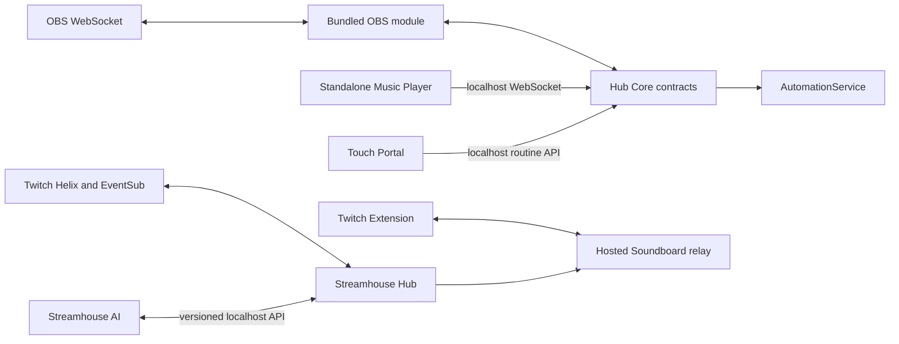
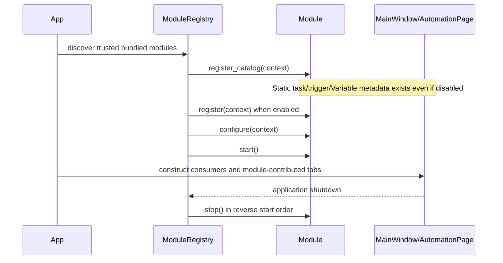

# Streamhouse technical architecture

> Concise code-grounded overview. The exhaustive Hub implementation map remains
> [architecture/overview.md](architecture/overview.md); compatibility rules live
> in [development-policy.md](architecture/development-policy.md).

## Repository and products

```text
products/hub/                 Streamhouse Hub application
products/ai/                  Streamhouse AI application and engine
shared/streamhouse_shared/    Lightweight protocols, DTOs, policy
shared/streamhouse_runtime/   Paths, logging, JSON, redaction, Qt settings
shared/streamhouse_ui/        Reusable Qt presentation components
extensions/twitch/            Soundboard Extension and hosted relay
tools/                        Development, build, smoke, release tooling
tests/integration/            Cross-product boundaries
tests/release/                Packaging and release contracts
```

Entry points are `products/hub/hub_main.py` and `products/ai/ai_main.py`.
`products/hub/streamhouse_hub/app.py` creates QApplication, the trusted bundled
module registry, and `MainWindow`. Streamhouse AI starts its
own UI/server/provider process and is not bundled into Hub.

## System relationships



Hub Core is the bridge. Optional modules expose capabilities through Core;
they do not import one another or open duplicate provider connections.

## Hub Core services

Core-owned runtime contracts include:

- `AutomationService`, `RoutineStore`, `TaskRegistry`, and queue management;
- `VariableRegistry` and typed providers/output definitions;
- `ModuleRegistry`, `ActionRegistry`, and contribution registries;
- global synchronous `Events` notification;
- Backup, diagnostics, resources, secrets/settings, and window state; and
- Qt shell composition in `MainWindow`.

`Events.emit()` calls subscribers synchronously on the emitting thread. Worker
events that affect widgets must cross an owning Qt signal/slot bridge.

## Module contracts

Real contracts are defined in:

- `products/hub/modules/contracts.py` — `ModuleDescriptor`, `ModuleContext`, lifecycle/status;
- `products/hub/modules/registry.py` — deterministic lifecycle and reverse shutdown;
- `products/hub/modules/actions.py` — `ActionRegistry` and typed action descriptors/results;
- `products/hub/modules/contributions.py` — module tabs, trigger providers, Backup contributors;
- `products/hub/modules/discovery.py` — trusted bundled discovery; and
- `products/hub/modules/bootstrap.py` — Core capability set and registry creation.



In current code, `MainWindow` creates Core registries and calls
`_initialize_modules()` before `_build_automation_page()`. Registration contexts
carry Core-owned registries plus commit/rollback callbacks. Duplicate IDs fail
deterministically. Disabled compatible modules participate in static catalog
registration but not runtime registration/configuration/startup.

Source discovery checks the known bundled directory and explicit allowlist.
Frozen discovery uses the explicit allowlist because PyInstaller embeds Python
packages without physical source directories. Neither mode imports arbitrary
third-party code.

## OBS module conversion

The first bundled module is `streamhouse.obs` under
`products/hub/modules/bundled/obs/`.

It owns:

- `ObsWebSocketService` lifetime and connection state;
- existing OBS configuration and trigger stores;
- OBS event subscription and normalized Automation dispatch;
- OBS task handlers and registered actions;
- `obs.*` and connection Variables;
- the OBS primary tab and Automation Defaults UI;
- safe OBS Backup contribution; and
- cancellation/disconnect during module shutdown.

Core retains Automation, routines, queues, VariableRegistry, trigger-provider
registry, navigation rendering, and Backup orchestration. Existing public files
remain under `obs/`, including DPAPI-protected `password.dat`. No migration or
dual runtime was introduced.

When disabled, `register_catalog()` still registers task handlers, provider
metadata, Variables, and the trigger store. Availability reports false, tasks
are skipped without deleting configuration, and triggers cannot fire because
the module does not subscribe/start. Re-enabling and restarting restores the
same persisted IDs and references.

Remaining coupling is presentation-oriented: Core Automation editor,
simulation, transfer, and Wiki code still imports stable OBS task/trigger
definitions. Runtime construction and lifecycle are module-owned.

## Twitch module conversion

Twitch conversion is **implemented / accepted** at feature code commit
`dba19eb5e6a8da2160664440dff9917e37bd2965`. Phase 1 added the trusted bundled
module `streamhouse.twitch` under `products/hub/modules/bundled/twitch/` and moves
production registration of Twitch task metadata, contextual Variable
definitions, task-provider availability, and the Twitch trigger-provider
catalog behind `register_catalog()`.

Static registration occurs for compatible disabled modules, so saved Twitch
tasks and triggers remain interpretable and contextual Variables remain
discoverable with honest unavailable state.

Phase 2 makes that module the sole owner of broadcaster/bot authentication,
protected-token maintenance, `TwitchService`, Helix/EventSub/chat transport,
trigger correlation, and orderly runtime shutdown. `app.py` and `MainWindow` no
longer construct or independently start/stop a Twitch runtime.

Phase 3 adds a generic Automation-subpage contribution contract. Twitch now
contributes its `Twitch` workspace through the module tab registry and its
Commands authoring page under Automation. The module owns the command store,
dispatcher, worker lifecycle, and Twitch Backup projections; Core continues to
own Automation execution and Backup orchestration. Counters remain Core-owned
and are presented under Automation. Public paths, schemas, task/trigger IDs,
command IDs, and routine references are unchanged.

Twitch connection maintenance is module-owned. Routine broadcaster/bot token
validation or refresh updates protected credentials without recreating live
transports. Native EventSub session transfers preserve subscription continuity
and the global Connected state. Unexpected transport interruption uses one
owned retry timer, reports a concise Reconnecting state, and rebuilds
subscriptions only after a replacement session welcome. Transport diagnostics
remain in Logs rather than Chat, and module stop or explicit sign-out prevents
late recovery callbacks from reopening transports or restoring stale tokens.

## Automation execution

`AutomationService.publish_trigger()` matches linked routines by stable trigger
ID, resolves the routine's queue, and executes ordered task definitions through
`TaskRegistry`. Nested routines retain the same root execution scope.
Conditions and control-flow tasks live in Core; provider actions remain with
their providers. Completed executions produce bounded/sanitized Run History.

Task providers return `TaskExecutionResult`. The module foundation extends this
with an explicit skipped state for unavailable providers so later tasks can
continue. Task outputs are typed definitions under `automation.*` and are
cleared at root execution completion.

## Variable resolution

`products/hub/automation/variable_registry.py` defines the only Variable
resolution and rendering path. Providers publish typed definitions and resolve
snapshots from live cached state or execution context. Dotted namespaces avoid
ambiguous flat placeholders. Contextual values (`user.*`, event-specific data)
and task outputs remain scoped to the triggering root execution. Provider
resolution must not initiate network work.

## Persistence and data ownership

Durable stores are domain-owned JSON or protected secret files under the Hub
data root. Stable IDs connect routines, triggers, queues, counters, Variables,
groups, and referenced tasks across stores. Writes use atomic JSON helpers and
current-schema validation. Released old schemas enter isolated migrations;
feature stores do not permanently dual-read old/current formats.

`BackupManager` owns manifests, hashes, staging, validation, safety backup,
commit, and rollback. Components and module contributors expose only eligible
data. Credentials, chat/message history, logs, diagnostics, and AI-owned data
remain excluded. Detailed paths and schema versions are maintained in
[architecture/overview.md](architecture/overview.md#persistence-and-data-ownership).

## External integration boundaries

- Twitch uses official Helix/EventSub through `products/hub/twitch/`.
- OBS uses OBS WebSocket through the bundled module and `products/hub/obs_service/`.
- Music consumes the standalone player's versioned localhost protocol only.
- Touch Portal uses Hub's versioned loopback routine API and stable routine IDs.
- Streamhouse AI uses shared versioned presence/HTTP DTOs; Hub never imports its engine.
- Soundboard public relay traffic uses the separately deployed Extension service.

## Startup and shutdown

Current startup is:

1. `hub_main.py` establishes data-root ownership and diagnostics.
2. `streamhouse_hub.app` creates/configures QApplication.
3. Twitch auth/service and the trusted bundled registry are created.
4. `MainWindow` creates stores and Core registries.
5. static module catalogs register;
6. enabled contributions register, configure, and start;
7. Automation and module-tab UI consumers are built;
8. deferred local integrations and optional auto-connects start; and
9. Qt enters its event loop.

Shutdown stops module runtimes in reverse start order, cancels outstanding
requests, disconnects services, flushes persistence/diagnostics, clears event
listeners, and releases single-instance ownership through the outer runner.

## Current boundaries versus future direction

| Area | Current state | Future direction |
| --- | --- | --- |
| OBS | First accepted bundled module | Preserve public contracts and use the proven Core contribution lifecycle |
| Twitch/Music | Core-wired services | No conversion scheduled in current task |
| Navigation | Main buttons/stack plus contributed OBS tab | Reorderable scrolling top; pinned Modules/Settings/Wiki |
| Docks | Developer dock only; no module dock registry | Optional live-use dock contributions |
| Module management | Persisted enablement and restart semantics | User-facing Modules page |
| Third-party modules | Explicitly unsupported | Trust/signing/marketplace remains deferred |
| Broadcaster abstraction | OBS-specific actions plus Core registry | Add only after another real provider proves requirements |

## Verification infrastructure

Use `tools/development/run_tests.ps1` so temp files stay under ignored
`.test-tmp/`. Product tests live beside each product; cross-product and release
tests live under `tests/integration/` and `tests/release/`. Package-boundary
tests prevent Hub/AI cross-imports and optional module-to-module imports.
PyInstaller builds are produced by `tools/build/`; packaged smoke uses
`STREAMHOUSE_DATA_DIR` and `STREAMHOUSE_SMOKE_TEST`.
