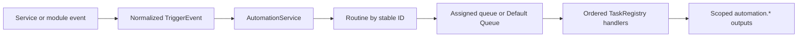

# Streamhouse master reference

> Long-term product and architecture continuity reference.
>
> Verified through final OBS module acceptance and integration into `develop`
> on 2026-10-25. Use [DEVELOPMENT_STATUS.md](DEVELOPMENT_STATUS.md) for the
> current working state and [ARCHITECTURE.md](ARCHITECTURE.md) for code-level
> structure.

## Status language

- **IMPLEMENTED**: verified in current code and covered by current behavior or tests.
- **PARTIAL**: a working slice exists, but the stated direction is incomplete.
- **PLANNED**: accepted direction recorded in repository documentation, not implemented.
- **PROPOSED**: an idea under consideration without an accepted implementation contract.
- **UNKNOWN**: repository evidence is insufficient; do not assume behavior.

## Vision and philosophy

Streamhouse is a Windows-first, local-first ecosystem for managing and
automating a livestream. The product principle is: simple things should be
simple, while advanced workflows should emerge by composing stable, focused
capabilities. Hub should remain useful without optional products or cloud
infrastructure. The hosted Soundboard relay is the intentional exception.

The governing engineering rules are [development-policy.md](architecture/development-policy.md)
and [codex-task-rules.md](development/codex-task-rules.md). In particular:

- **IMPLEMENTED/POLICY** — user data takes precedence over implementation convenience;
- **IMPLEMENTED/POLICY** — protect user data, not obsolete architecture;
- **IMPLEMENTED/POLICY** — released schemas are migration inputs into one current runtime;
- **IMPLEMENTED/POLICY** — stable IDs are authoritative and names are presentation data;
- **IMPLEMENTED/POLICY** — `VariableRegistry` is the sole Variables architecture; and
- **IMPLEMENTED/POLICY** — blocking work stays off the Qt UI thread.

## Product family

The canonical ownership document is [product-family.md](architecture/product-family.md).

| Product | Status | Responsibility and dependency |
| --- | --- | --- |
| Streamhouse Hub | **IMPLEMENTED** | Independent desktop integration and automation application. |
| Streamhouse AI | **IMPLEMENTED** | Separate local AI application; owns providers, reasoning, personality, extraction, training review, and reports. Live stream actions pass through Hub. |
| Soundboard Twitch Extension | **IMPLEMENTED** | Separately deployed viewer frontend and hosted relay under `extensions/twitch/`. |
| Streamhouse Studio | **PLANNED** | Independent broadcasting product with optional versioned Hub integration. |
| Streamhouse Deck | **PLANNED** | Remote-control product that depends on Hub and consumes Core contracts. |
| Streamhouse Avatar | **PLANNED** | Independent avatar product with optional integrations. |
| Broadcaster/PRISM providers | **PLANNED** | Future peer modules; no generic broadcaster routing is implemented. |

Sally is an AI character within Streamhouse AI, not shared infrastructure or
the umbrella product name.

## Hub Core

Hub Core owns shared orchestration rather than provider-specific behavior.

| Capability | Status | Current owner |
| --- | --- | --- |
| Routines, task execution, queues, Run History | **IMPLEMENTED** | `products/hub/automation/` |
| Variables and task outputs | **IMPLEMENTED** | `VariableRegistry` and typed providers/outputs |
| Module lifecycle and enablement | **IMPLEMENTED** | `products/hub/modules/registry.py` and `settings.py` |
| Cross-provider actions | **IMPLEMENTED** | `ActionRegistry` |
| Module tab, trigger-provider, and Backup contributions | **IMPLEMENTED** | `products/hub/modules/contributions.py` |
| Trusted first-party module discovery | **IMPLEMENTED** | `BundledModuleDiscovery` plus bundled allowlist |
| Module management page | **PLANNED** | Core shell; enablement currently has no complete user-facing Modules page |
| General dock contribution/persistence | **PLANNED** | Contract direction documented, not implemented |
| Third-party marketplace/loader/hot unload | **PLANNED/DEFERRED** | Explicitly outside the 0.3 foundation |

`MainWindow` remains the large Qt composition root. It may construct and wire
Core components, but domain services, stores, and substantial widgets belong
to focused owners. Reducing remaining coupling is incremental work, not a
reason to duplicate runtime paths.

## Module architecture

The primary rule is:

> Streamhouse Hub is the integration layer between modules. Modules expose
> capabilities and state through Hub Core contracts; modules do not import or
> establish private connections to one another.

### Discovery and registration

- **IMPLEMENTED** — the bundled location is `products/hub/modules/bundled/`.
- **IMPLEMENTED** — only factories in `trusted_bundled_module_specs()` load.
- **IMPLEMENTED** — source development verifies trusted directory presence.
- **IMPLEMENTED** — frozen/PyInstaller builds use the explicit trusted catalog
  because embedded Python packages do not exist as physical source folders.
- **PLANNED** — downloaded third-party code, dependency solving, signing, and trust UI.

### Lifecycle

`ModuleRegistry` implements deterministic lifecycle phases:

1. discovery and compatibility evaluation;
2. static `register_catalog()` for compatible modules, including disabled modules;
3. `register()` for enabled contributions;
4. `configure()`;
5. `start()`;
6. reverse-order `stop()`.

Static catalogs exist before Automation UI consumption so disabled providers
remain interpretable and visible as unavailable. Duplicate stable IDs are
errors; load order never selects a winner. Enable/disable takes effect after
restart. Runtime hot unload is not implemented.

### Accepted OBS module conversion

The OBS conversion is **IMPLEMENTED/ACCEPTED** and integrated into `develop`:

- **IMPLEMENTED** — module ID `streamhouse.obs`;
- **IMPLEMENTED** — service lifecycle, connection state, triggers, Variables,
  actions, module tab, safe Backup contribution, and shutdown belong to the OBS module;
- **IMPLEMENTED** — existing paths, protected password semantics, task/trigger
  IDs, and routine references are preserved;
- **IMPLEMENTED** — disabled OBS keeps static definitions and skips tasks as unavailable;
- **IMPLEMENTED** — packaged enabled/disabled/re-enabled startup, Automation
  compatibility, triggers, Variables, Backup, Default Audio Input, and clean
  shutdown passed final acceptance;
- **FOLLOW-UP** — Core Automation editor, simulator, transfer, task metadata,
  and Wiki adapters retain stable OBS-specific presentation/contract knowledge.
  This does not duplicate runtime ownership or create module-to-module coupling.

## Automation

Automation remains mandatory Hub Core infrastructure.

- **IMPLEMENTED** — triggers are domain-owned persisted definitions that emit
  normalized `TriggerEvent` values.
- **IMPLEMENTED** — routines and nested tasks are Core-owned and retain stable IDs.
- **IMPLEMENTED** — queues serialize routine execution with Default Queue fallback.
- **IMPLEMENTED** — task providers register handlers in `TaskRegistry`.
- **IMPLEMENTED** — provider-unavailable tasks can remain configured and record a skip.
- **IMPLEMENTED** — task outputs are canonical `automation.*`, visible only after
  their producer within the root routine execution.
- **IMPLEMENTED** — Python Script tasks run trusted local code out of process.
- **PARTIAL** — tasks execute in the Hub process and affinity/blocking safety is
  enforced handler by handler rather than by a generic background executor.

## Variables

`VariableRegistry` owns definitions, providers, availability, typed snapshots,
context/lifetime rules, validation, rendering, Variable Picker metadata, and
domain-routed writes. Canonical placeholders use dotted names. Trigger context
and `automation.*` outputs must remain execution-scoped; live providers must not
perform network requests during resolution. Legacy flat placeholders are not a
supported runtime architecture.

## Counters and queues

- **IMPLEMENTED** — `CounterService` owns decimal-safe values across configured
  viewer/current-stream/channel-lifetime scopes and uses stable counter IDs.
- **IMPLEMENTED** — one Counter task may update a selected non-empty subset of
  configured scopes while preserving existing single-scope routine behavior.
- **IMPLEMENTED** — current stream identity comes from authoritative Twitch
  session state; offline state never fabricates an ID.
- **IMPLEMENTED** — `AutomationQueueStore` and `AutomationQueueManager` own
  persisted queue policy and serialized execution.

## External integrations

| Integration | Status | Boundary |
| --- | --- | --- |
| Twitch | **IMPLEMENTED** | Helix + EventSub services under `products/hub/twitch/`; currently Core-wired, not converted to a module. |
| OBS | **IMPLEMENTED/ACCEPTED** | First accepted bundled module; WebSocket transport remains under `products/hub/obs_service/` and lifecycle owner is `streamhouse.obs`. |
| Local Music Player | **IMPLEMENTED** | Versioned localhost WebSocket; independent player owns discovery files, token, state, and playback. |
| Streamhouse AI | **IMPLEMENTED** | Separate process using versioned localhost presence/HTTP contracts; Hub contains no model runtime. |
| Touch Portal | **IMPLEMENTED/EXPERIMENTAL** | Loopback API lists and runs routines by stable ID. |
| Soundboard Extension | **IMPLEMENTED** | Hosted relay plus local Hub polling/preview boundary. |

## UI and workspace direction

- **IMPLEMENTED** — current tab/button navigation remains the primary UI.
- **IMPLEMENTED** — modules can contribute primary tabs; OBS contributes one.
- **PLANNED** — reorderable, scrollable top navigation region.
- **PLANNED** — bottom-pinned Modules, Settings, and Wiki entries.
- **PLANNED** — optional docks for live-use panels such as platform chat and
  Broadcaster controls; docks do not replace main tabs.
- **PARTIAL** — Your Channel contains working Chat, Analytics, Raid, Commands,
  Channel Information, Channel Points, Counters, and Users areas; the proposed
  Stream Info/Engagement/Moderation structure is not fully implemented.

## Streamhouse AI

Streamhouse AI is independently packaged under `products/ai/`. It owns Ollama
provider access, reply reasoning, Sally personality behavior, memory extraction,
training review, and test reports. Hub owns Twitch delivery, consent/send gates,
and stream actions. The shared packages contain only lightweight protocols,
models, policies, presence, runtime, and reusable UI primitives.

Current AI behavior and privacy rules are documented in
[local-ai.md](ai/local-ai.md). Future provider or personality work must not move
heavy `products/ai/engine/` dependencies into Hub.

## Persistence and compatibility

Public Hub releases through `v0.2.1-alpha` are present in Git. Every schema
shipped publicly is a supported upgrade input. Core Backup orchestrates
manifest validation, checksums, safety copies, staging, commit, and rollback;
domain/module contributors supply only eligible owned data. Secrets, chat
history, logs, and diagnostics are excluded according to the existing privacy
contracts. See [overview.md](architecture/overview.md#persistence-and-data-ownership)
and [release-checklist.md](architecture/release-checklist.md).

## Confirmed decisions

- Hub, AI, and future peer products keep meaningful package/process boundaries.
- Automation and Variables remain Core.
- Optional modules depend on Core contracts, not one another.
- Static provider metadata does not require runtime activation.
- OBS is the first module extraction; Twitch and Music are not converted yet.
- Current tab navigation remains primary; docking is supplementary live-use UI.
- No third-party module ecosystem is being built in the 0.3 foundation.

## Proposed features and unresolved questions

The detailed open questions remain in
[hub-0.3-foundation.md](architecture/hub-0.3-foundation.md). High-level items:

- **PLANNED** — user-facing Modules page and restart-required enablement workflow.
- **PLANNED** — navigation ordering and module tab persistence.
- **PLANNED** — dock contribution and recovery contract.
- **PLANNED** — evidence-based later module conversions after the accepted OBS foundation.
- **PROPOSED** — Broadcaster/PRISM provider modules and live-use panels.
- **PROPOSED** — stronger generic provider routing only after more than one real provider exists.
- **UNKNOWN** — final third-party trust, signing, dependency, and marketplace model.

## Roadmap

1. **IMPLEMENTED** — public Alpha foundation through `v0.2.1-alpha`.
2. **IMPLEMENTED** — Core 0.3 module contracts and trusted discovery on `develop`.
3. **IMPLEMENTED/ACCEPTED** — OBS is the first accepted bundled module; packaged
   startup and public-data compatibility passed final acceptance.
4. **PLANNED** — Modules/navigation/docking UX only when contracts are proven.
5. **PROPOSED** — additional first-party modules and future products through Core contracts.

This roadmap expresses direction, not release promises or dates.
